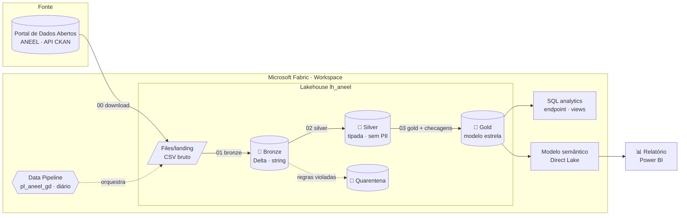
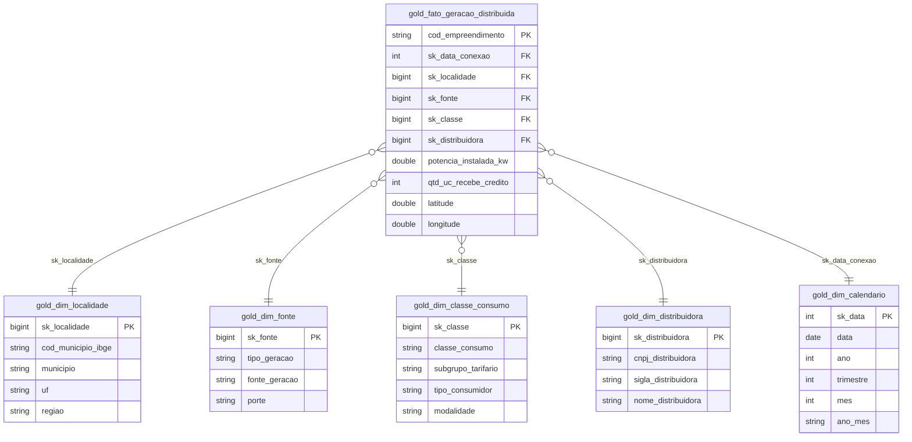

<div align="center">

# ⚡ Lakehouse de Geração Distribuída · ANEEL

**Pipeline de dados ponta a ponta no Microsoft Fabric com a base pública de micro e minigeração distribuída do Brasil**

[](https://github.com/gilbertosales/fabric-lakehouse-aneel/actions/workflows/ci.yml)


</div>

---

## 🎯 O problema

O Brasil passou de alguns milhares para **milhões de sistemas de geração distribuída** em poucos anos, puxados pela energia solar. A ANEEL publica o cadastro completo como dado aberto, mas o arquivo é um CSV de vários GB, em `latin-1`, com números no formato brasileiro, dados pessoais dos titulares e registros inconsistentes.

Este projeto transforma esse arquivo bruto em um **modelo analítico confiável**, atualizado automaticamente e pronto para Power BI, respondendo perguntas como:

- Quanto de potência solar foi conectada por estado e por mês? Como está a curva de crescimento?
- Quais municípios e distribuidoras concentram mais sistemas?
- Como se dividem as modalidades (autoconsumo remoto, geração compartilhada) e as classes de consumo?

## 🏗️ Arquitetura



| Camada | O que acontece | Tabelas |
|---|---|---|
| **Landing** | Download do CSV via API CKAN, particionado por `data_carga` | `Files/landing/geracao_distribuida/` |
| **🥉 Bronze** | Esquema fixo (tudo string), colunas de linhagem, overwrite só da partição do dia | `bronze_geracao_distribuida` |
| **🥈 Silver** | Tipagem, decimal brasileiro → `double`, **remoção de CPF/CNPJ e nome do titular**, 5 regras de qualidade, deduplicação e `MERGE` incremental | `silver_geracao_distribuida`, `..._quarentena` |
| **🥇 Gold** | Modelo estrela com chaves hash estáveis, agregado mensal com acumulado e checagens de integridade | `gold_fato_*`, `gold_dim_*`, `gold_agg_*`, `log_qualidade` |

## ⭐ Modelo dimensional



Medidas DAX do modelo semântico em [`powerbi/medidas.dax`](powerbi/medidas.dax).

## 🧠 Decisões de engenharia

| Decisão | Por quê |
|---|---|
| **Lógica em pacote Python, notebooks finos** | As transformações vivem em `src/aneel_lakehouse` e são testadas com PySpark local no CI. Os notebooks do Fabric só orquestram leitura e escrita. |
| **Bronze 100% string** | Uma mudança de formato na fonte nunca quebra a ingestão; a tipagem fica na silver, onde há testes. |
| **LGPD por construção** | CPF/CNPJ e nome do titular não saem da bronze. `garantir_sem_pii()` derruba a execução se uma dessas colunas vazar. |
| **Quarentena em vez de descarte** | Registro inválido vai para uma tabela com o motivo (`potencia_positiva`, `coordenadas_no_brasil`…). A carga falha se a taxa passar de 5%. |
| **Chaves substitutas via `xxhash64`** | São determinísticas: a fato e as dimensões podem ser recalculadas de forma independente sem quebrar os relacionamentos. |
| **`MERGE` + `OPTIMIZE ZORDER`** | Carga incremental idempotente e leitura rápida por UF e data no Direct Lake. |
| **Checagens de qualidade bloqueantes** | Unicidade, integridade referencial e volume são gravados em `log_qualidade`. Se algo reprovar, o modelo semântico não é atualizado com dado ruim. |

## 📂 Estrutura

```text
fabric-lakehouse-aneel/
├── src/aneel_lakehouse/     # pacote instalado no Environment do Fabric
│   ├── schemas.py           # colunas, PII, nomes de tabelas
│   ├── bronze.py            # leitura do CSV + linhagem
│   ├── silver.py            # tipagem, validação, quarentena, deduplicação
│   ├── gold.py              # dimensões, fato, agregados
│   └── quality.py           # checagens e log de qualidade
├── notebooks/               # 00 landing → 01 bronze → 02 silver → 03 gold
├── sql/gold_views.sql       # views no SQL analytics endpoint
├── powerbi/medidas.dax      # medidas do modelo semântico Direct Lake
├── tests/                   # pytest + PySpark local com amostra sintética
├── docs/                    # implantação no Fabric e dicionário de dados
└── .github/workflows/ci.yml # lint + testes + wheel
```

## 🚀 Como executar

### Localmente (testes)

```bash
python3.11 -m venv .venv && source .venv/bin/activate
pip install -e ".[dev]"
pytest -v          # 14 testes, ~30 s
```

Requer Java 17 (o mesmo do Fabric Runtime 1.3). A amostra em `tests/fixtures/` é **sintética** e cobre casos de borda: acentos em latin-1, decimal brasileiro, duplicatas e registros inválidos.

### No Microsoft Fabric

Passo a passo em [`docs/implantacao-fabric.md`](docs/implantacao-fabric.md). Em resumo: criar o Lakehouse, publicar o wheel do CI num *Environment*, importar os notebooks e montar o pipeline diário.

## 🗺️ Próximos passos

- [ ] Deployment pipeline (Dev → Prod) com Fabric Git integration
- [ ] Alertas do Data Activator quando a taxa de quarentena subir
- [ ] Enriquecer com irradiação solar (INPE) e população (IBGE) por município

## 📜 Fonte e licença

Dados: [ANEEL · Relação de empreendimentos de Geração Distribuída](https://dadosabertos.aneel.gov.br/dataset/relacao-de-empreendimentos-de-geracao-distribuida), licença aberta do portal. Código sob licença MIT.

---

<div align="center">
Feito por <a href="https://github.com/gilbertosales">Gilberto Sales</a> · <a href="https://www.linkedin.com/in/gilberto-gomes-de-sales-3a979651">LinkedIn</a>
</div>
