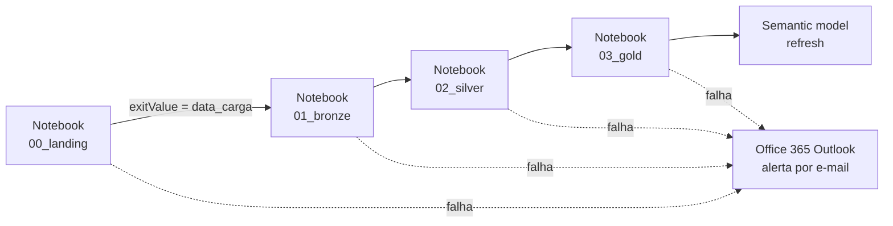

# Implantação no Microsoft Fabric

Guia para reproduzir o projeto num workspace com capacidade Fabric (F2 ou trial já bastam).

## 1. Lakehouse

1. No workspace, **Novo item → Lakehouse**, nome `lh_aneel`.
2. Deixe o esquema padrão `dbo`. As tabelas Delta serão criadas pelos notebooks.

## 2. Environment com o pacote

1. Rode o CI (ou `pip wheel --no-deps -w dist .`) e baixe `aneel_lakehouse-1.0.0-py3-none-any.whl`.
2. **Novo item → Environment**, nome `env_aneel`, Runtime **1.3 (Spark 3.5)**.
3. Em *Custom libraries*, faça upload do wheel e clique em **Publish**.
4. Defina `env_aneel` como environment padrão do workspace, ou selecione-o em cada notebook.

## 3. Notebooks

Importe os arquivos de `notebooks/` (**Importar → Notebook**) e anexe `lh_aneel` como Lakehouse padrão em cada um.

| Notebook | Parâmetros |
|---|---|
| `00_landing_download` | `data_carga` |
| `01_bronze` | `data_carga`, `id_execucao` |
| `02_silver` | `data_carga` |
| `03_gold` | `id_execucao` |

A célula com tag `parameters` recebe os valores do pipeline.

## 4. Data Pipeline `pl_aneel_gd`

- `data_carga`: `@activity('00_landing').output.result.exitValue`
- `id_execucao`: `@pipeline().RunId`
- Agendamento: diário, 06:00 (America/Sao_Paulo). A ANEEL atualiza o conjunto mensalmente, mas a carga é idempotente.

## 5. SQL analytics endpoint

Abra o endpoint SQL do `lh_aneel` e execute `sql/gold_views.sql`.

## 6. Modelo semântico Direct Lake

1. No Lakehouse, **Novo modelo semântico**, selecionando as tabelas `gold_*`.
2. Crie os relacionamentos do diagrama do README (todos 1:N, filtro único).
3. Marque `gold_dim_calendario` como tabela de datas (coluna `data`).
4. Cole as medidas de `powerbi/medidas.dax`.
